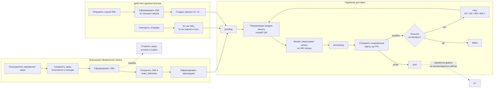
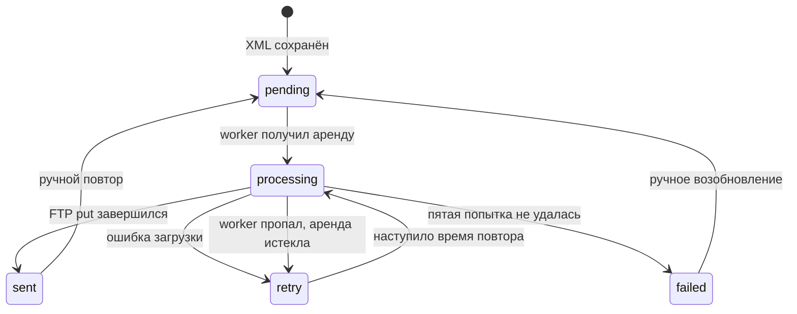

# Концепция применения outbox для доставки заказов

Outbox решает проблему двух независимых систем: базы сайта и FTP. При непосредственной отправке во время оформления могут возникнуть два неоднозначных состояния:

- заказ записался в БД, но процесс завершился до отправки XML;
- XML отправился, но сайт не успел записать успешный результат.

В outbox заказ и предназначенный для отправки XML сохраняются одной транзакцией. Поэтому возможны только два исхода: сохранены и заказ, и доставка либо не сохранено ничего. Сетевой вызов происходит позже и не удерживает транзакцию БД.

Запись `order_deliveries` одновременно служит очередью и журналом доставки:

## Основные свойства

- XML каждой версии неизменяем. Изменения каталога или заказа не влияют на его повторную отправку.
- «Повторить отправку» отправляет те же байты по тому же пути.
- «Отправить новый XML» создаёт отдельную версию из актуального сохранённого состояния заказа.
- Два worker не отправляют одну запись одновременно благодаря токену и сроку аренды.
- Потерянный job не означает потерю доставки: планировщик снова найдёт `pending`, `retry` или просроченный `processing`.
- Гарантия доставки — **at least once**. Если процесс завершился после FTP put, но до записи `sent`, XML будет отправлен повторно.
- Состояние `sent` означает успешную загрузку файла на FTP. Обработку файла в 1С сайт не отслеживает.

## Роль состояний

| Состояние | Значение |
| --- | --- |
| `pending` | XML сохранён и ожидает первой или ручной отправки |
| `processing` | Worker владеет временной арендой и выполняет отправку |
| `retry` | Предыдущая попытка не удалась; назначено время следующей |
| `sent` | FTP подтвердил успешную загрузку файла |
| `failed` | Автоматические попытки исчерпаны; требуется ручное действие |

## Повтор и новая версия

Повтор доставки и изменение заказа являются разными операциями:

| Действие | XML | Версия | Назначение |
| --- | --- | --- | --- |
| Повторить отправку | Сохранённые байты без изменений | Прежняя | Восстановить доставку того же сообщения |
| Отправить новый XML | Формируется из текущего заказа | Новая (`v2`, `v3` и далее) | Передать актуальное состояние заказа отдельным сообщением |

Поведение 1С при получении повторного или нового файла находится за границами сайта. Задача outbox заканчивается после надёжной загрузки XML на FTP.
